# Credit Risk Cut-off Strategy · Home Credit 2024

**Can a consumer lender approve more applicants without raising its bad rate?** A credit-policy analysis on 1.5 million real loans: where the cut-off should sit, who would swap in and out, and how much money is at stake. Built the way a credit-risk team would: point-in-time data, a champion scorecard vs a challenger model, a cost matrix, a swap set, a three-tier policy, fair-lending checks and a monitoring plan.

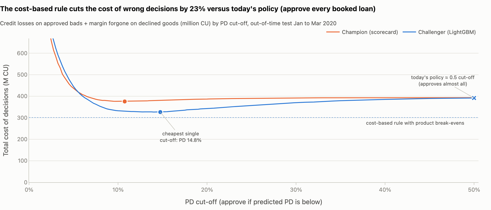

*Credit losses on approved loans that default plus margin given up on good customers who were declined, by PD cut-off (out-of-time test, January to March 2020). Compared with today's policy, which approved every loan in this book (a 0.5 cut-off lands in the same place), the cost-based rule cuts the total cost of wrong decisions by 23%.*

## The business problem

The Head of Credit Policy asked: *"The business wants a higher approval rate, but the bad rate must not go up. Is there room on the current cut-off? If we move it, who goes from declined to approved, who goes from approved to declined, and how much money is at stake?"* ([request and scope](docs/01_request_and_scope.md))

**Data:** Home Credit "Credit Risk Model Stability" (Kaggle 2024): 1,526,659 booked consumer loans (cash, point-of-sale and revolving), decisions 2019-01-01 to 2020-10-05, 3.14% defaulted. Headline numbers are on an out-of-time test quarter (January to March 2020, 222,681 loans, bad rate 4.41%). Every loan in the data was approved by the lender's past policy, so approval rates below are shares of *previously approved* applicants; people the lender rejected are not in the data.

## Three conclusions

1. **Set the cut-off from what a wrong decision costs.** A defaulted loan costs about 60% of its amount; a wrongly declined good customer costs the product's margin. That gives one break-even PD per product (cash 25%, revolving 14%, point-of-sale 8%). Applied with the challenger model, the rule declines **9.3%** of today's approvals, a group that defaulted at **16.6%**, and lowers the approved book's bad rate from 4.41% to **3.17%**: **+92.3M CU** over the quarter versus today's policy (95% interval 86.0M to 98.7M).
2. **On the current scorecard there is room to tighten but none we can prove to loosen; a better model creates room.** Against a rebuilt scorecard applying the same rule, the gradient-boosted challenger approves **+3.3 percentage points** more applicants at the same bad rate (95% interval 2.9 to 3.6; about 2,458 more booked loans a month), or cuts credit losses by **22%** at the same approval rate (20% to 23%). Under the recommended policy, swap-outs default at 14.7% and swap-ins at 7.1%. Most of the gain comes from using more of the available information: of the 11.6-point Gini gap, LightGBM on the scorecard's own 16 inputs closes only 2.7.
3. **Approving people the lender rejects today needs a test, not a model.** Their bad rate was never observed. Each loan declined from the risky tail can fund new approvals at an unchanged bad rate only if those new applicants default at less than 16.6%. A below-cut-off test of about **589 loans** just below today's approval line (≈ 2.6M CU of expected net losses, more if today's rejects are riskier than the tail) would measure it; a pass (a bad rate of 12.5% or less) would fund about 1.5 new approvals per declined loan, roughly 10,600 extra loans a quarter.

The work also found and fixed a **look-ahead leak** in the source data: the pre-computed "history" fields were measured about 14 days *after* each credit decision. History features were rebuilt as of the decision date; fields that could not be rebuilt were dropped, at a measured cost of less than one Gini point ([data-quality checks](docs/03_data_quality_checks.md)).

## Recommendations

| For | Do | Expected impact | How to measure | Main risk |
|---|---|---|---|---|
| Head of Credit Policy | Adopt the cost-based rule as the cut-off policy (break-even PD 25.0% cash, 14.3% revolving, 7.7% point-of-sale), once Finance confirms the margins | Decline 9.3% of today's approvals (bad rate 16.6%); +92.3M CU a quarter | Approval rate; bad rate of approved loans by vintage; net profit | Margins are assumptions; Finance must sign off the cost matrix |
| Model Risk / Validation | Validate the challenger and run a champion/challenger test (20% of traffic, stratified by product) | +3.3 pp approvals at the scorecard's bad rate, or 22% lower credit losses at the same approval rate | 32,438 approved loans per arm; 30+ days past due at month 3 for an early read | Less transparent than a scorecard; decline reasons (SHAP) must run in production |
| Credit Policy + Finance | Run a below-cut-off test on a random sample of applicants just below today's approval line (applicants the current policy rejects), with capped amounts | Measures the bad rate of today's rejects, the number that decides whether approvals can rise | Bad rate of test approvals vs the declined tail (~589 loans) | Expected net cost ≈ 2.6M CU, a floor if today's rejects are riskier than the tail |
| Underwriting operations | Route the grey zone to manual review within capacity; log review outcomes | 3,711 reviews a month on booked-loan volume (reset on through-the-door volume); +11.8M CU a quarter if reviewers catch 40% of bad applicants | Review hit rate, cost per case | Value depends on a hit rate that is not yet measured |
| Compliance | Approve the excluded-attribute list and decline-reason library; review age and sex calibration gaps | Documented fair-lending position before go-live | Approval-rate ratio and calibration by group, quarterly | Inputs still carry age information |
| Risk analytics | Monthly monitoring: score and feature stability, calibration, early delinquency, overrides | Population and outcome shifts caught within one to three months | Alerts raised and actioned | Outcome metrics lag; early delinquency shortens the lag |

Full decision memo: [docs/readout.md](docs/readout.md) · one-page summary: [reports/executive_summary.md](reports/executive_summary.md) · full report (one HTML file, opens offline): [reports/report.html](reports/report.html) · model documentation: [docs/model_card.md](docs/model_card.md) · cut-off and swap-set pack: [docs/cutoff_and_swap_set.md](docs/cutoff_and_swap_set.md)

## Key charts

| Approval rate vs bad rate | Swap set under the recommended policy |
|---|---|
| 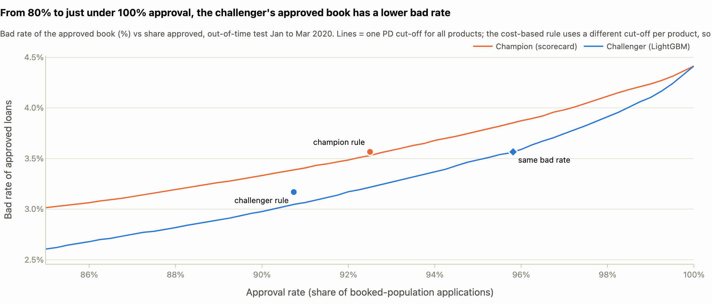 | 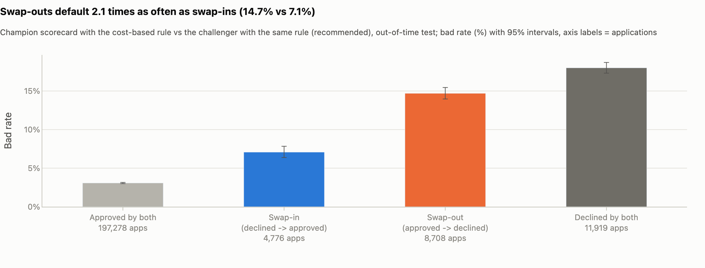 |
| At any approval rate the challenger's approved book has a lower bad rate. | Swap-outs default about twice as often as swap-ins. |

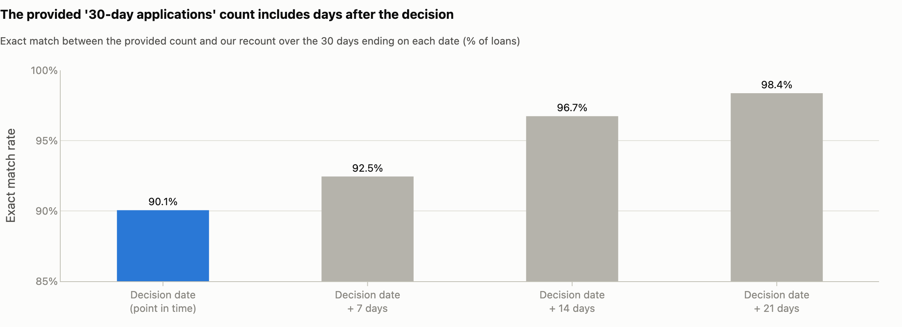

*Evidence for the look-ahead leak: the provided "applications in the last 30 days" matches a recount ending at the decision date for only 90.1% of loans; the match rises to 92.5%, 96.7% and 98.4% as the recount window is moved to end 7, 14 and 21 days after the decision.*

## The demo app (Streamlit, 7 pages)

`streamlit run dashboard/app.py` · pages follow the story; three of them recompute live from sliders and selectors.

| | |
|---|---|
| 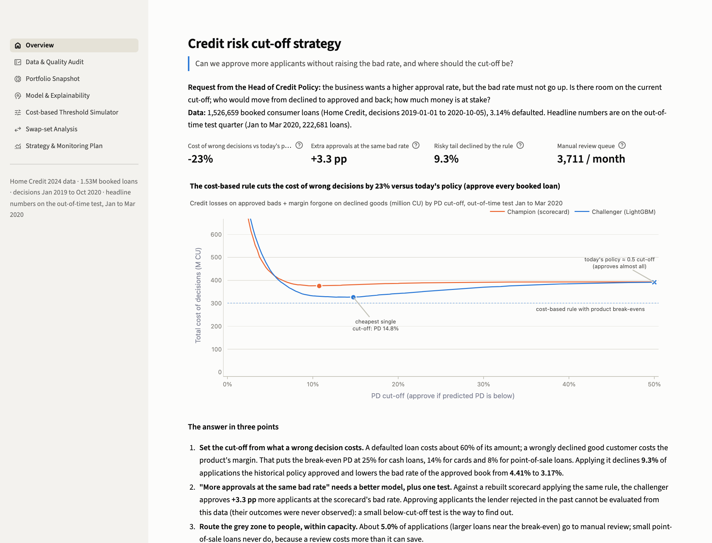 **Overview** · the answer and the loss curve | 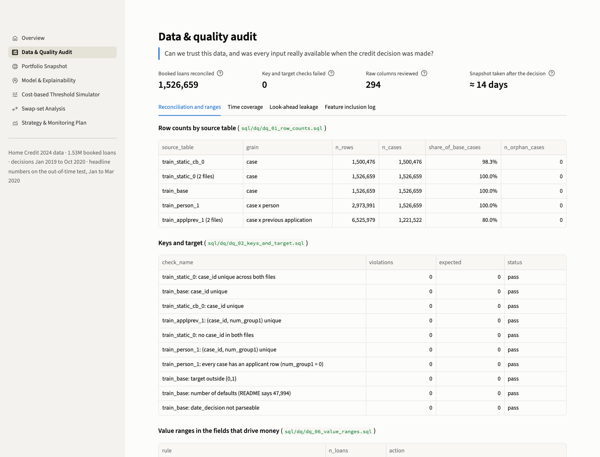 **Data & Quality Audit** · reconciliation, leakage evidence, feature log |
| 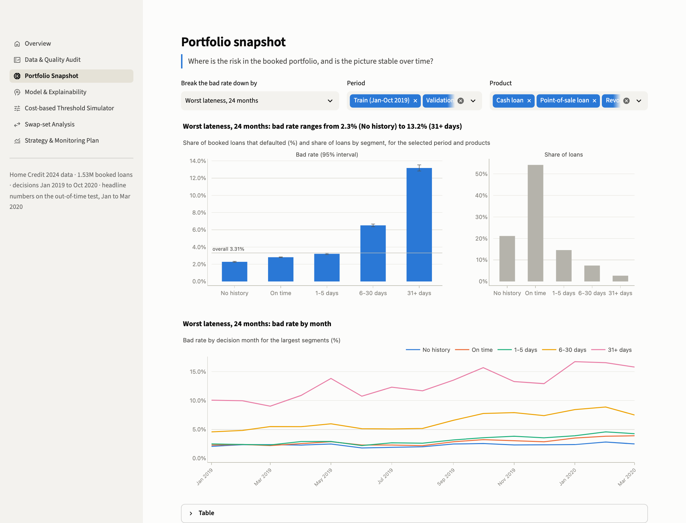 **Portfolio Snapshot** · bad rate by segment, period and product | 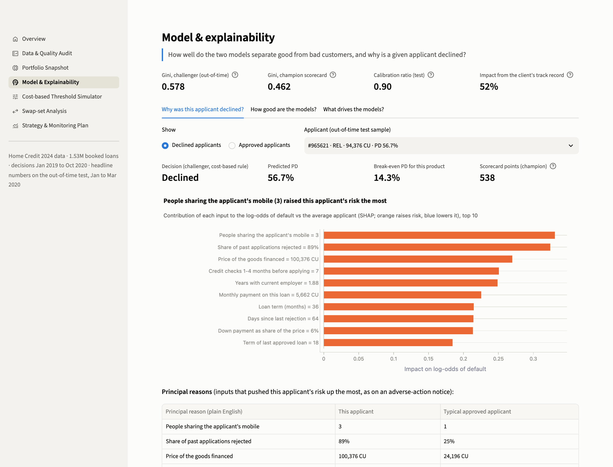 **Model & Explainability** · why a given applicant is declined |
| 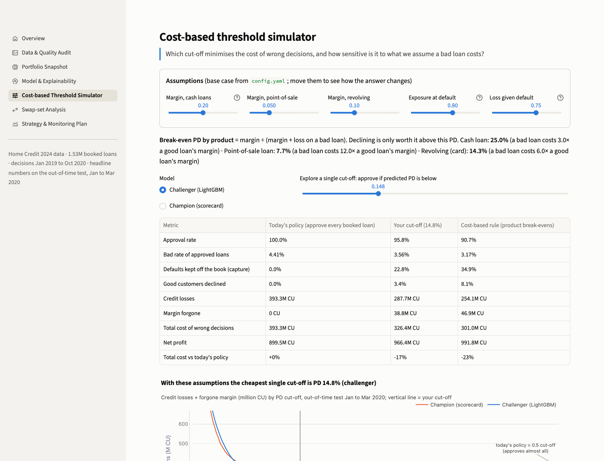 **Cost-based Threshold Simulator** · move the cost assumptions, watch the cut-off move | 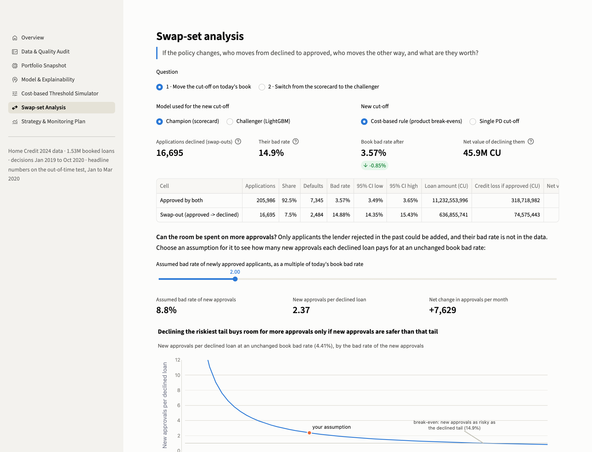 **Swap-set Analysis** · who swaps in and out, headroom |
| 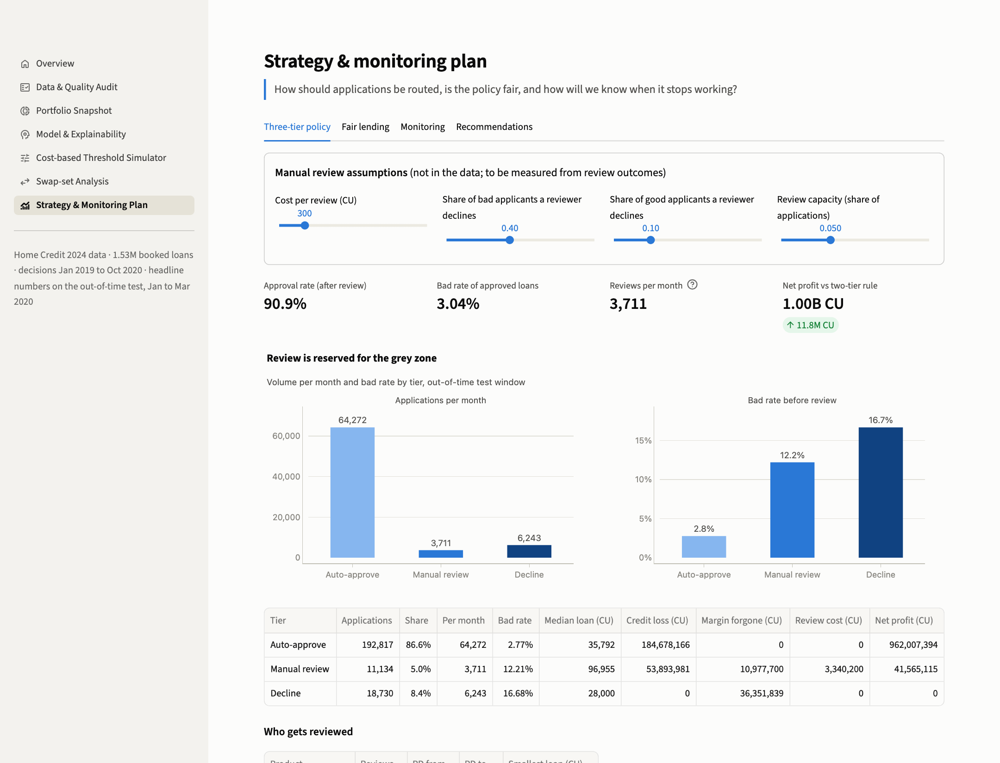 **Strategy & Monitoring Plan** · three tiers, fairness, monitoring, recommendations | |

## How it was done

| Step | What | Where |
|---|---|---|
| Scope and metrics | Request, decision, constraints; metric definitions written before touching the data | [01](docs/01_request_and_scope.md), [02](docs/02_metric_definitions.md), [assumptions](docs/assumptions.md) |
| Data audit | Row counts, keys, target, time range, value ranges; point-in-time tests that exposed the 14-day snapshot leak | [sql/dq/](sql/dq), [notebook 01](notebooks/01_data_audit.ipynb), [03](docs/03_data_quality_checks.md) |
| Features | 294 raw columns reviewed one by one → 90 point-in-time features built in DuckDB SQL; fair-lending exclusions; leak ablation | [sql/](sql), [feature log](docs/feature_inclusion_log.csv), [notebook 02](notebooks/02_feature_eng.ipynb) |
| Models | Champion: 16-variable WOE logistic-regression scorecard (points, monotonic bins). Challenger: LightGBM. Both calibrated; time-based split; no resampling (tested) | [notebook 03](notebooks/03_modeling.ipynb), [model card](docs/model_card.md) |
| Policy | Cost matrix → product break-even PDs; cut-off table; swap sets; headroom; three-tier policy within capacity; fairness; monitoring back-test; test sizing | [notebook 04](notebooks/04_threshold_and_strategy.ipynb), [cut-off and swap set](docs/cutoff_and_swap_set.md) |

Out-of-time test (January to March 2020): challenger Gini 0.578 vs scorecard 0.462. Rank-ordering is reported in the model card; decisions are made on money.

<details>
<summary>Repository layout</summary>

```
config.yaml            data path, time split, cost and review assumptions
run.py / Makefile      one-command pipeline
sql/                   DuckDB feature build (01-06) and data-quality checks (dq/)
src/                   config, DB runner, features catalog, metrics, economics, strategy, modelling, explanations, charts, report
notebooks/             01 data audit · 02 feature engineering · 03 modelling · 04 threshold and strategy (executed, with outputs)
dashboard/             Streamlit app (app.py + views/)
docs/                  plan, scope, metric definitions, data-quality checks, assumptions, model card, cut-off and swap set, readout
reports/               report.html, executive summary, notebook HTML exports, figures, metrics.json
scripts/               SQL independence check, dashboard QA click-through, screenshots
tests/                 unit tests: cost and policy formulas, scorecard points and reason codes, stability index
```
</details>

## Limitations

- **Selection bias.** Only approved applicants have outcomes. Approval rates are shares of the approved population; the bad rate of past rejects is unknown (reject inference), which is why loosening needs a test.
- **Assumptions drive the money.** Margins, loss given default and reviewer effectiveness are not in the data ([assumptions](docs/assumptions.md)); money figures move with them, the ranking of policies does not.
- **Calibration drift.** The models were calibrated on a 3.5% quarter and tested on a 4.4% quarter; predicted PDs run about 10% low on the test window (the spread of risk is right: calibration slope 0.99) and need recalibration on the latest mature vintage.
- **The April 2020 break.** From April 2020 monthly volume falls by about 86% and the bad rate halves in one step, then stays flat. It may reflect COVID-era measures, the lender's own tightening or loans too recent to have defaulted (the outcome horizon is not disclosed); the data cannot separate these, so the monitoring back-test is illustrative.
- **Booked-loan volumes.** Monthly volumes (reviews, extra approvals, test durations) are on booked loans; operational plans must be reset on through-the-door volume.
- **Undisclosed target and currency.** The default definition and horizon are Home Credit's; amounts are in undisclosed currency units (CU).
- **Associations, not causes.** Segment differences and decline reasons describe how inputs and risk move together in approved loans.

## How to run

Needs Python 3.12, [uv](https://docs.astral.sh/uv/), the Kaggle data, and on macOS `brew install libomp` (LightGBM).

```bash
git clone https://github.com/edwinzhang98/credit-risk-analysis.git
```

```bash
cd credit-risk-analysis && make setup
```

```bash
make all
```

```bash
make app
```

- **Data path.** By default the raw parquet files are read from `~/projects/data-projects/datasets/p2-comp-home-credit-2024/parquet_files/train` (see `config.yaml`). To use another location, edit `data_dir` in `config.yaml` or set `HC_DATA_DIR=/path/to/parquet_files/train`. The data comes from the Kaggle competition *Home Credit - Credit Risk Model Stability* (accept the rules, then `kaggle competitions download -c home-credit-credit-risk-model-stability`). No raw or row-level data is stored in this repository.
- `make all` (same as `python run.py`) builds the DuckDB feature tables, runs the data-quality SQL, executes the four notebooks, exports them to HTML and builds `reports/report.html`.
- Other commands: `make sql-check` (runs every SQL file on its own), `make test` (unit tests), `make qa` (clicks through every dashboard page and tab in a headless browser), `make screenshots`.
- Static PNG copies of the charts (README images, chart images inside the notebooks) are drawn with kaleido, which needs a local Chrome or Chromium. Without one, everything still runs and the charts stay interactive only. `make qa` and `make screenshots` need `.venv/bin/python -m playwright install chromium` once.
