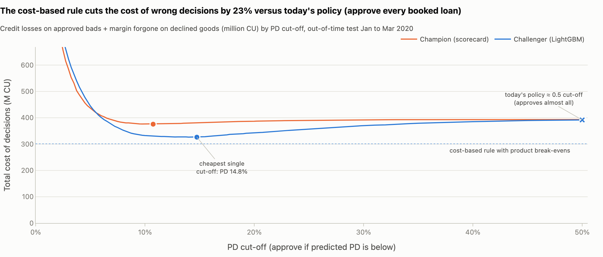

# Executive summary: is there room on the cut-off?

*For the Head of Credit Policy. Out-of-time test quarter: decisions January to March 2020, 222,681 booked loans, 4.41% defaulted. Money is in the dataset's currency units (CU). The current scorecard is the champion, a stand-in we rebuilt because the lender's incumbent model is not in the data; the new model is the LightGBM challenger. Gains are measured against today's policy, which approved every loan in this book (a 0.5 cut-off approves 99.98% of it and lands in the same place); 95% intervals come from 200 loan-level resamples of the test quarter.*

**Answer in one sentence.** There is room to tighten and none we can prove to loosen: a cut-off set from what a wrong decision costs, run on a better model, lowers the approved book's bad rate from 4.41% to 3.17% and adds 92.3M CU a quarter against today's policy, while approving people we reject today needs a 589-loan test, because their outcomes were never observed.

## Key figures

| Metric (test quarter) | Value | What it means |
|---|---|---|
| Approvals the cost-based rule would decline | 9.3% (20,627 loans, 1,062.4M CU) | Their bad rate was 16.6%, almost four times the book's 4.41% |
| Bad rate of the approved book | 4.41% to 3.17% | Lower than today's book, as the business required |
| Credit losses | 35% lower (393.3M to 254.1M CU) | Versus today's policy; the total cost of wrong decisions (losses plus margin given up) is 23% lower |
| Net profit | +92.3M CU a quarter (95% sampling interval 86.0M to 98.7M; 56.6M to 147.7M across the margin assumptions) | 139.2M CU of losses avoided less 46.9M CU of margin given up; by month 29.4M, 37.0M and 25.8M |
| New model versus a rebuilt scorecard, same rule | +3.3 pp approvals at the same bad rate (2.9 to 3.6; about 2,458 booked loans a month), or 22% lower credit losses at the same approval rate (20% to 23%) | A better model creates room the scorecard cannot |
| Price of knowing whether approvals can rise | 589 test loans, about 2.6M CU or more | Expected net loss on a below-cut-off test of applicants just below today's approval line (today's rejects); a floor, priced on the declined tail |

*Credit losses on approved loans that default plus margin given up on declined good customers, by cut-off. Today's policy approved every loan in this book (a 0.5 cut-off lands in the same place); the cost-based rule (dotted line) uses a break-even per product and beats any single cut-off.*

## Three findings

1. **Set the cut-off from what a wrong decision costs.** A bad loan costs about 60% of its amount; a wrongly declined good customer costs the product's margin (20% cash, 10% revolving, 5% point-of-sale). One rule, approve when expected profit is positive, therefore gives three cut-offs: an estimated chance of default below 25.0%, 14.3% and 7.7%. On the current scorecard it declines 7.5% of today's approvals (bad rate 14.9%), worth 45.9M CU a quarter; on the new model, 9.3% (bad rate 16.6%), worth 92.3M CU.
2. **The new model ranks applicants more accurately, and that is where the room comes from.** Against a rebuilt scorecard applying the same rule, it approves 95.8% instead of 92.5% at the scorecard's bad rate, or cuts credit losses by 22% at the scorecard's approval rate; most of the edge comes from using more of the available information (90 inputs against 16), not from the algorithm alone, and a scorecard with its variable cap lifted (23 variables) closes only 24% of the Gini gap. Switching the rule from the scorecard to the new model, 8,708 loans (576.0M CU) move from approved to declined (swap-outs) and defaulted at 14.7%; 4,776 loans (150.4M CU) move the other way (swap-ins) and defaulted at 7.1%, a gap of 7.6 points (6.6 to 8.6). A manual-review tier for the grey zone (5.0% of applications, 3,711 cases a month: the team's full assumed capacity, so of about 5,988 cases a month worth reviewing only the most valuable are kept) adds 11.8M CU a quarter if reviewers catch 40% of bad applicants, still to be measured.
3. **Loosening cannot be read from the data.** Every loan in the data was approved under the old policy, so the bad rate of past rejects is unknown. Each declined tail loan funds more than one new approval at an unchanged bad rate only if the newcomers default at less than 16.6%: 2.8 new approvals per declined loan if they default at 8.8%, 1.5 at 12.5%, 1.4 at 13.2%, one for one (no net gain) at 16.6%. The number that decides it must come from a test of applicants just below today's approval line, those the current policy rejects: a pass (a bad rate of 12.5% or less, a quarter below the tail) would fund about 1.5 new approvals per declined loan, roughly 10,600 more loans a quarter.

## Three decisions requested

1. **Adopt the cost-based rule** as the cut-off policy, once Finance confirms the margin and loss assumptions behind it.
2. **Approve a controlled trial of the new model** on 20% of applications (20,544 approved loans in the challenger arm and 82,176 in the champion arm, about 1.5 months of booked-loan volume), with the manual-review tier and a decision rule written before it starts, after validation and with a plain-language reason for every decline. Compliance signs off the fair-lending position (approval rates 90.8% women, 90.6% men; lowest age-band ratio 0.89, above the 0.80 screen).
3. **Fund the below-cut-off test** (589 approved loans; expected net losses of about 2.6M CU, a floor because today's rejects are probably riskier than the declined tail they are priced on) and a monitoring plan that tracks outcomes as well as applicant mix: in April to October 2020 the bad rate halved and both models' risk estimates ran 34% to 66% above actual while the new model's score mix barely moved; the scorecard's score mix shifted more, but in step with a collapse in the fill rate of the employment field, not with the outcome shift.

## Caveats

- **Selection bias.** All 1,526,659 loans in the data (decisions January 2019 to October 2020, 3.14% defaulted) were approved by the historical policy. Approval rates here are shares of previously approved applicants, not through-the-door rates, and the bad rate of past rejects is unknown.
- **Assumptions drive the money, not the direction.** Margins, the 60% loss on a bad loan and the 40% reviewer catch rate are assumptions; the 56.6M to 147.7M CU range above covers the margins only. The models were calibrated on November to December 2019 (two months, bad rate 3.51%); their estimates ran 6% to 18% below actual by month in January to March 2020 (over the quarter, 10% for the new model and 14% for the scorecard) and 34% to 66% above it from April 2020, so they need refreshing before go-live. With every applicant's estimated odds of default raised 25% before the rule is applied, profit under the new model's rule moves by 0.2%.
- **The April 2020 break.** In April 2020 volume fell about 86% in one month (60,748 loans in March, 8,289 in April) and was back at March's level by September (61,905; the data end on 5 October), while the bad rate halved in one step and stayed flat. The lower bad rate may reflect COVID-era measures, the lender's own tightening or loans too recent to have defaulted (the outcome horizon is not disclosed); the data cannot separate these, so the monitoring back-test is illustrative. It is also not blind: two employment fields were dropped partly because their collection stopped in June 2020, and inputs that had already shifted by the test quarter were put on the stability list.
- **Booked-loan volumes.** The 3,711 reviews a month, the 2,458 extra loans a month and the 1.5 months of trial volume are counted on booked loans; the review queue and test durations must be reset on through-the-door volume.
